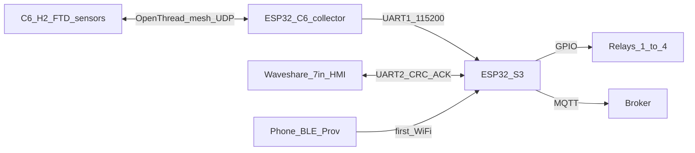
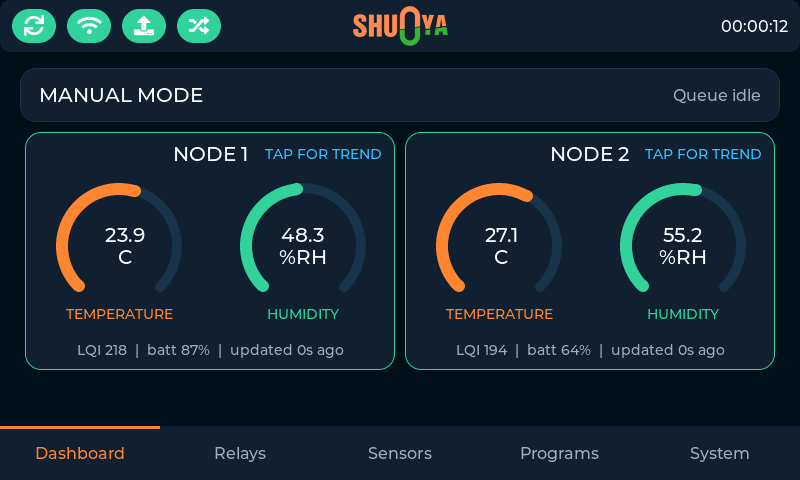
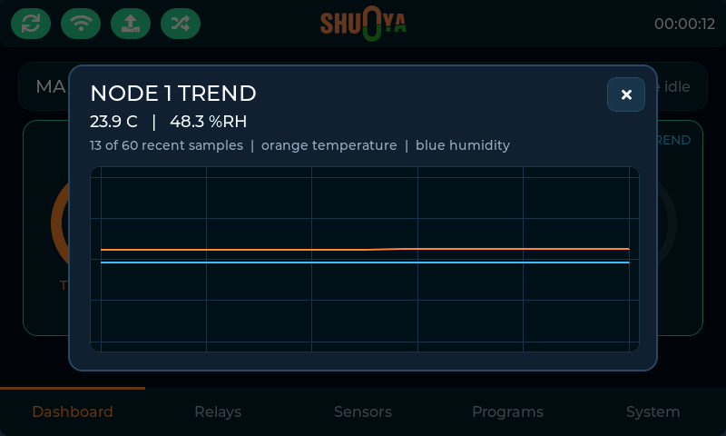
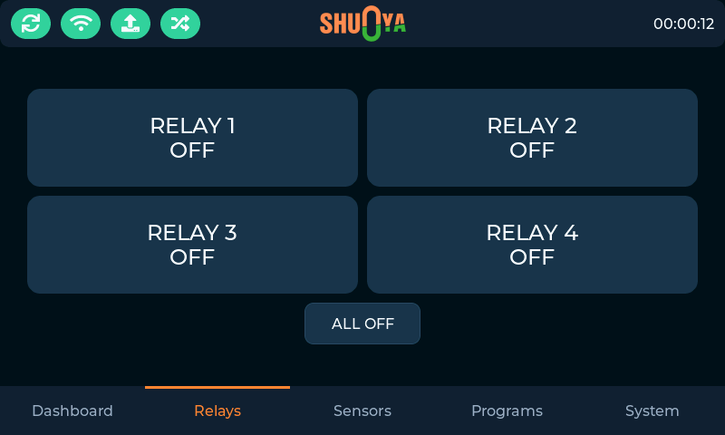
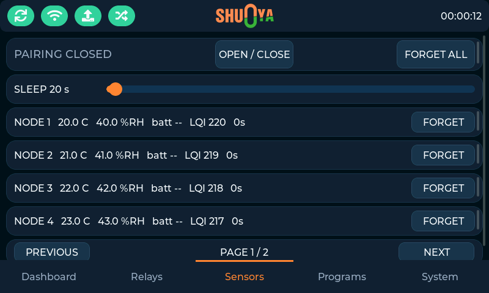
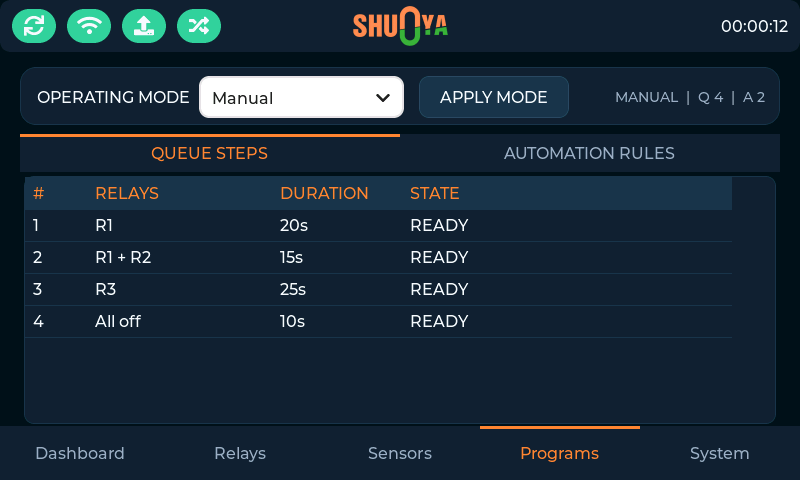
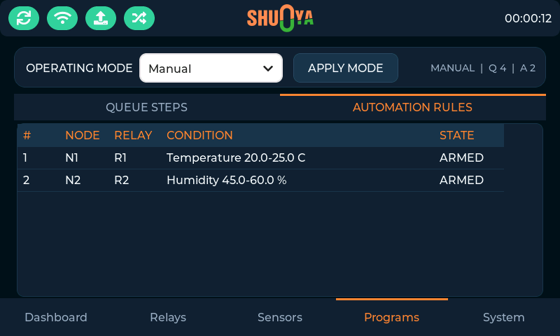
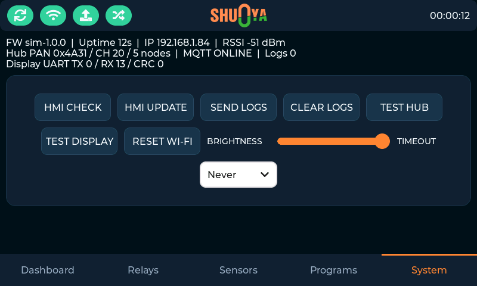

# Shunya ESP-B Gateway

Firmware **4.0.1** for a dual-MCU climate / irrigation controller.

The **gateway ESP32-S3** (4D Systems gen4, 16 MB flash) is the product brain: four relays, MQTT, Wi-Fi provisioning, OTA, and four operating modes. An on-device **ESP32-C6** is the Zigbee coordinator. A separate **Waveshare ESP32-S3-Touch-LCD-7** is the 800×480 local HMI and communicates with the gateway over a reliable versioned UART protocol.

A second **ESP32-C6** runs the sleepy Zigbee sensor firmware in this repo.
Sensors report temperature, humidity, and battery percentage, and they use a
user-configurable sleep/report interval (default 20 s, 5–3600 s).

---

## Contents

1. [What it does](#what-it-does)
2. [Hardware](#hardware)
3. [How it works](#how-it-works)
4. [Repository layout](#repository-layout)
5. [Installation](#installation)
6. [Build and flash](#build-and-flash)
7. [First boot](#first-boot)
8. [Pairing Zigbee sensors](#pairing-zigbee-sensors)
9. [DHT sensor node](#dht-sensor-node)
10. [MQTT usage](#mqtt-usage)
11. [Operation modes](#operation-modes)
12. [Waveshare touchscreen HMI](#waveshare-touchscreen-hmi)
13. [UART link test](#uart-link-test)
14. [Boot button](#boot-button)
15. [OTA updates](#ota-updates)
16. [Offline event log](#offline-event-log)
17. [Configuration](#configuration)
18. [Troubleshooting](#troubleshooting)
19. [Security notes](#security-notes)

---

## What it does

| Function | Who |
|---|---|
| Wi-Fi STA, BLE provisioning, MQTT, NTP (IST) | S3 |
| Four relays (GPIO 8, 18, 16, 15) | S3 |
| Manual / automation / queue / hybrid control | S3 |
| HMI state snapshots and validated touch commands | S3 UART2 |
| HTTP OTA with dual-bank rollback | S3 |
| Zigbee coordinator, node slots 1–16 | C6 hub |
| Temp / humidity / battery reports → UART | C6 hub |
| DHT11/22 read + sleepy Zigbee end device | C6/H2 sensor |

Up to **16** Zigbee sensors. Logical IDs `1–16` are used consistently by MQTT,
automation rules, persistence, and the paginated HMI.

---

## Hardware

### Gateway (S3)

- Board env: `4d_systems_esp32s3_gen4_r8n16`
- Relays: GPIO **8, 18, 16, 15** (outputs, HIGH = on)
- Boot / reset-hold: GPIO **0**
- Debug USB serial: 115200
- Waveshare HMI link: UART2 **RX 44 / TX 43**, 115200 8N1
- Hub link: UART1 **RX 4 / TX 5**, 115200 8N1

These are the compiled pins in [`src/gateway/config.h`](src/gateway/config.h). If board revisions require different pins, change both ends of that UART and preserve crossed TX/RX wiring.

### Zigbee hub (ESP32-C6)

- Default PlatformIO board: `esp32-c6-devkitc-1`
- UART1 **TX GPIO 5 / RX GPIO 4**, 115200 8N1
- Debug console on UART0 / USB-Serial-JTAG

### Wiring S3 ↔ C6 hub

Cross TX and RX. Common GND. 3.3 V as designed on the PCB.

```
ESP32-S3 gateway                 ESP32-C6 hub
GPIO 5 TX   ------------------>  GPIO 4 RX
GPIO 4 RX   <------------------  GPIO 5 TX
GND           ------------------  GND
```

Optional later: an S3 GPIO to C6 **EN** so factory reset can hard-reset the hub. That line is not implemented yet.

### DHT sensor (ESP32-C6)

Separate board from the hub. Default wiring in [`src/sensor/sensor_config.h`](src/sensor/sensor_config.h):

```
DHT22 (default) or DHT11
  VCC  →  3.3 V
  GND  →  GND
  DATA →  GPIO 6   (internal pull-up enabled; add 4.7 kΩ to 3.3 V if reads fail)
BOOT   →  GPIO 9   (DevKitC-1 BOOT): hold 3 s to reset Zigbee state and restart
```

For DHT11, set `#define DHT_MODEL 11` and rebuild `zigbee_sensor_c6`.

### Waveshare ESP32-S3-Touch-LCD-7

- 800×480 ST7262 RGB panel, GT911 capacitive touch, CH422G reset/backlight expander
- 16 MB flash / 8 MB OPI PSRAM configuration
- Native USB CDC is reserved for logs and flashing
- Set the board UART selector so GPIO43/44 route to the external terminal

Cross the HMI and gateway UART and share ground:

```
Waveshare HMI                    ESP32-S3 gateway
GPIO 43 TX  ------------------>  GPIO 44 RX
GPIO 44 RX  <------------------  GPIO 43 TX
GND         -------------------  GND
```

Do not connect either side's 5 V output to the other. Power both boards from their intended supply and join only GND plus the two 3.3 V UART signals.

---

## How it works



### S3 tasks (FreeRTOS)

Each resource has one owner:

| Task | Core | Role |
|---|---|---|
| `mqttTask` | 0 | Wi-Fi reconnect, NTP check, MQTT connect/subscribe/loop, drain publish queue, status every 10 s |
| `otaTask` | 0 | Version check, firmware download |
| `hubTxTask` / `hubRxTask` | 1 | UART to C6 hub |
| `sensorTask` | 1 | Joins, leaves, sensor samples → EEPROM / MQTT |
| `displayRxTask` | 1 | Validate HMI frames and enqueue typed commands |
| `linkTestTask` | 0 | USB-serial UART tests (hub + display) |
| `relayTask` | 1 | GPIO writes only |
| `modeTask` | 1 | MQTT and HMI commands, automation/queue/hybrid, pairing timeout, boot button |

Incoming MQTT is copied onto `cmdQueue`; the callback does not touch GPIO, EEPROM, or HTTP.

### C6 Zigbee coordinator

The hub forms a Zigbee network and stays closed to joining until `PAIR_OPEN`.
Sensors are sleepy end devices. They only join during the 120-second
permit-join window.

1. `PAIR_OPEN` opens Zigbee permit-join for up to 120 seconds.
2. An unknown ZED that announces while the window is open is assigned slot
   1–16, persisted in NVS, and reported as `HUB_EVT_JOINED`.
3. Sensors report temperature, humidity, and battery over ZCL. The hub
   forwards `HUB_EVT_SENSOR` (23-byte payload including battery and sleep).
4. `HUB_CMD_SET_SLEEP` writes the global report interval (5–3600 s) to each
   node while it is awake after a report.

### Identity

- MQTT client id and topic prefix: S3 station MAC with colons removed (e.g. `AABBCCDDEEFF`).
- Zigbee sensor: IEEE address + short address, mapped to logical `nodeId` 1–16.
  IEEE is the reconciliation key.

---

## Repository layout

```
platformio.ini
partitions_16mb_3mb_ota_spiffs.csv
sdkconfig.defaults              # shared FreeRTOS tick
sdkconfig.defaults.hub_c6       # C6 Zigbee coordinator
sdkconfig.defaults.sensor_c6    # C6 DHT sleepy ZED
sdkconfig.defaults.sensor_h2_demo # H2 serial-input sleepy ZED
partitions_zigbee.csv           # shared 4 MB-safe Zigbee/NVS table
src/idf_component.yml           # ESP-IDF >=5.1; Zigbee libs for C6/H2
src/common/                     # Shared UART codec + Zigbee cluster IDs (C)
src/gateway/                    # S3 Arduino application
src/display/                    # Waveshare HMI firmware, board port and LVGL UI
src/hub/                        # C6 ESP-IDF Zigbee coordinator
src/sensor/                     # C6 DHT and H2 serial-demo Zigbee ZEDs
scripts/shunya_build.py         # OS-independent IDF / HMI / release / simulator helper
scripts/idf-build.sh|.ps1       # Zigbee hub/sensor/demo wrapper
scripts/display-build.sh|.ps1   # isolated Arduino 3.x HMI wrapper
scripts/build-release-binaries.sh|.ps1
tests/system_test_cases.csv     # release acceptance and mode permutations
```

Default PlatformIO env is `gateway_s3`.

---

## Installation

### Tools

1. [PlatformIO Core](https://docs.platformio.org/en/latest/core/installation.html) or the PlatformIO IDE extension.
2. USB drivers for the 4D programmer / S3 USB-Serial-JTAG and for ESP32-C6 boards (hub and sensor).
3. Python 3 (comes with PIO).

Confirm:

```bash
pio --version
python3 --version          # Windows: python --version
```

The Zigbee and HMI wrappers need the PlatformIO `penv` Core
(`~/.platformio/penv/bin/pio` on macOS/Linux,
`%USERPROFILE%\.platformio\penv\Scripts\pio.exe` on Windows). If `penv` is
missing, install/update the PlatformIO IDE extension before running the
wrappers; they isolate package stores so the gateway Arduino 2.x Core, the
pioarduino ESP-IDF Core, and the Arduino 3.x HMI Core do not overwrite each
other.

On Linux, add your user to the `dialout` (Debian/Ubuntu) or `uucp` (some
distros) group so `/dev/ttyACM*` is usable without root:

```bash
sudo usermod -aG dialout "$USER"
```

Log out and back in after that. macOS uses `/dev/cu.usbmodem*` or
`/dev/cu.usbserial*`. Always pass `--port` when more than one board is plugged
in.

### ESP-IDF / Zigbee (C6 and H2)

The `zigbee_hub_c6`, `zigbee_sensor_c6` and `zigbee_sensor_h2_demo`
environments use **ESP-IDF 5.5.5**, not Arduino. Zigbee is provided by
`esp-zboss-lib` / `esp-zigbee-lib`.
so no external Zigbee/ZBOSS managed components are installed.

These envs run on the pioarduino platform (ESP-IDF 5.5.5) in a separate package
store, driven by `scripts/shunya_build.py` — see [Build and flash](#build-and-flash).
Override `board` in `platformio.ini` if you are not using `esp32-c6-devkitc-1`.

The first run through the script creates `C:\pio-idf` (Windows) or
`~/.pio-idf` (macOS/Linux) and populates it. It
reuses the archives already cached under `~/.platformio/.cache`, so it does not
re-download the ~2.4 GB of toolchains, but expect the initial extraction to take
several minutes. Let it finish; interrupting it leaves a half-extracted
toolchain that must be deleted before retrying.

### MQTT client (PC / phone)

Any MQTT 3.1.1 client (MQTT Explorer, mosquitto, Home Assistant). Broker host, port, and credentials are compiled into [`src/gateway/config.h`](src/gateway/config.h). Transport is **plaintext MQTT** (port 1883), not TLS.

### Phone app for Wi-Fi

Espressif **ESP BLE Provisioning** (or equivalent). Proof-of-possession is `abcd1234`. BLE name is `Shunya ` plus the S3 MAC (colons included in the name string).

---

## Build and flash

Connect **one** USB cable at a time, or set upload ports explicitly.

**Never run two builds at the same time.** Both stacks install packages before
compiling, and concurrent runs corrupt each other's toolchains mid-extraction.

### Three package stores, deliberately kept apart

The gateway, Thread nodes, and HMI use incompatible framework/package versions. Each stack therefore has its own command, package store and build directory:

| Target | Platform | PlatformIO Core | Package store | Build directory | Command |
|---|---|---|---|---|---|
| `gateway_s3` | official `espressif32@7.1.2` (Arduino core 2.0.17) | system-wide | `~/.platformio` | `.pio/build` | `pio run -e gateway_s3` |
| Zigbee hub/sensor/demo | pioarduino (ESP-IDF 5.5.5, ESP32-H2) | pioarduino `penv` | `C:\pio-idf` or `~/.pio-idf` | `.pio/build-idf` | `python3 scripts/shunya_build.py idf …` |
| `display_s3` | pioarduino (Arduino core 3.3.11) | pioarduino `penv` | `C:\pio-display` or `~/.pio-display` | `.pio/build-display` | `python3 scripts/shunya_build.py display …` |

The build directories are separate for the same reason. PlatformIO keeps one
`project.checksum` per build directory and erases that whole directory when the
checksum changes, and the core directory is part of that checksum. With a
shared `.pio/build`, every switch between stacks silently deleted the previous
target's artifacts, and a deletion that raced a running build aborted it with
`The system cannot find the path specified`. The wrapper scripts set
`PLATFORMIO_BUILD_DIR`, so each stack keeps incremental state and all three
outputs can coexist.

They are separated because the two platforms pin different versions of
`tool-scons`, `tool-esptoolpy`, `toolchain-riscv32-esp` and `framework-espidf`
while installing into identically named folders. Sharing one store makes every
switch between environments delete and re-copy those packages, and on Windows
those copies fail on the 260-character path limit or on locked executables,
leaving the package broken. The two PlatformIO Cores likewise disagree: the
system Core pins SCons 4.11.1, pioarduino's Core pins SCons 4.8.1.

The wrapper scripts set this up. Always use them for Zigbee and display targets rather than calling `pio` directly. On Windows the display wrapper also uses `C:\pio-display-cache` to keep Arduino 3.x Matter extraction paths below the Win32 path limit; macOS/Linux use `~/.pio-display-cache`.

One collision needs its own note because it is silent. Both Arduino platforms
install a package literally named `framework-arduinoespressif32`: the official
platform ships Arduino 2.0.17 and pioarduino ships Arduino 3.3.11. They share
one folder, so building `gateway_s3` while `PLATFORMIO_CORE_DIR` still points
at the HMI store (`C:\pio-display` or `~/.pio-display`) replaces the Arduino 3.x package with the 2.x one. Because
the platform pins its requirement by tarball URL, the wrong package does not
satisfy it: PlatformIO drops the framework from its package list and the next
HMI build fails inside the Arduino builder with

```
TypeError: argument should be a str or an os.PathLike object where
__fspath__ returns a str, not 'NoneType'
```

which never mentions the framework. Two guards prevent this. The display
wrapper detects the wrong package by the absence of `tools/pioarduino-build.py`,
removes it and lets PlatformIO refetch Arduino 3.3.11. The release wrapper pins
the gateway store explicitly instead of inheriting the caller's shell. To repair
the store by hand, delete `packages/framework-arduinoespressif32` under the HMI
store and build again.

### Gateway (S3)

```bash
pio run -e gateway_s3
pio run -e gateway_s3 -t upload
pio device monitor -e gateway_s3
```

The S3 image uses the custom 16 MB table: dual **3 MB** OTA slots + SPIFFS. A successful first flash of this partition map is required before HTTP OTA can find a second bank.

Canonical helper (all hosts):

```bash
python3 scripts/shunya_build.py idf hub build
python3 scripts/shunya_build.py idf hub upload --port /dev/ttyACM0   # COM7 on Windows
python3 scripts/shunya_build.py display build
python3 scripts/shunya_build.py simulator build
```

Windows also keeps the previous PowerShell flags:

```powershell
.\scripts\idf-build.ps1 -Target hub -Action build
.\scripts\display-build.ps1 -Action upload -Port COM12
```

macOS / Linux shell wrappers:

```bash
./scripts/idf-build.sh hub build
./scripts/idf-build.sh hub upload --port /dev/ttyACM0
./scripts/display-build.sh upload --port /dev/cu.usbmodem1101
```

### Hub (C6)

```bash
python3 scripts/shunya_build.py idf hub build
python3 scripts/shunya_build.py idf hub upload
python3 scripts/shunya_build.py idf hub monitor
```

### DHT sensor (C6)

```bash
python3 scripts/shunya_build.py idf sensor build
python3 scripts/shunya_build.py idf sensor upload
python3 scripts/shunya_build.py idf sensor monitor
```

### Demo sensor (ESP32-H2, no DHT)

Use an **ESP32-H2-DevKitM-1 with 4 MB flash** for this target. Do not flash
the demo image onto the C6 hub or C6 DHT sensor.

```bash
python3 scripts/shunya_build.py idf demo build
python3 scripts/shunya_build.py idf demo upload --port /dev/ttyACM0
python3 scripts/shunya_build.py idf demo monitor --port /dev/ttyACM0
```

The H2 demo uses `SENSOR_DEMO_SERIAL=1`; it has no DHT and generates no random
readings. Keep its serial monitor open at 115200 and enter either accepted
line format followed by Enter:

```text
set 24.50 55.25
24.50 55.25
```

The first number is temperature in °C (`-40..80`); the second is relative
humidity in percent (`0..100`). Invalid, incomplete, non-numeric, NaN and
out-of-range lines are rejected without changing the last accepted sample.
Accepted values are converted to hundredths, sent immediately after Zigbee
join, then repeated on the configured sleep interval.

All three Zigbee envs share [`partitions_zigbee.csv`](partitions_zigbee.csv),
set from the `[pioarduino]` section. Zigbee persistent settings and the
hub's 16 slots share NVS; changing the table requires a full reflash.

For a clean rebuild, replace the target as needed:

```bash
python3 scripts/shunya_build.py idf hub clean
python3 scripts/shunya_build.py idf sensor clean
python3 scripts/shunya_build.py idf demo clean
```

ESP32-H2 support is why the Zigbee targets run on pioarduino; the official
platform has no H2 toolchain.

### Waveshare HMI (ESP32-S3)

```bash
python3 scripts/shunya_build.py display build
python3 scripts/shunya_build.py display upload --port /dev/ttyACM0
python3 scripts/shunya_build.py display monitor --port /dev/ttyACM0
```

The target pins LVGL 8.4.0, ESP32_Display_Panel 1.0.4, ESP32_IO_Expander 1.1.1, and esp-lib-utils 0.2.3. Its board definition enables the Waveshare ST7262/GT911/CH422G port, 16 MB flash, 8 MB OPI PSRAM, and native USB CDC. The first build downloads a large Arduino 3.x support package and can take several minutes.

`-Action clean` runs a full clean.

### Gateway + HMI release binaries

Build both S3 targets sequentially and collect flash/OTA artifacts:

```bash
python3 scripts/shunya_build.py release
```

Raw build outputs (forward slashes work on every host):

- Gateway: `.pio/build/gateway_s3/firmware.bin`
- HMI application: `.pio/build-display/display_s3/firmware.bin`
- HMI full image: `.pio/build-display/display_s3/firmware.factory.bin`
- Zigbee hub: `.pio/build-idf/zigbee_hub_c6/firmware.bin`
- C6 DHT sensor: `.pio/build-idf/zigbee_sensor_c6/firmware.bin`
- H2 serial demo: `.pio/build-idf/zigbee_sensor_h2_demo/firmware.bin`

ESP-IDF targets also generate `firmware.factory.bin` in their environment
folder when supported. Prefer each wrapper's `upload` action for first flash;
it selects all required offsets and the configured Zigbee partition table.

The script builds `gateway_s3` with the system core and `display_s3` through the
HMI wrapper, so it reads `.pio/build/gateway_s3` and
`.pio/build-display/display_s3`. It creates a timestamped folder
under `dist/firmware/`, and writes renamed gateway/HMI application binaries,
available bootloader/partition/factory images, and `manifest.json` containing
versions, sizes, targets and SHA-256 hashes. `gateway-boot_app0.bin` is taken
from the Arduino framework package, since that file never appears in a build
directory. Any artifact whose source is missing is now reported as a warning
instead of being dropped silently. To package already-built outputs without
rebuilding, use `-SkipBuild`. `dist/` is ignored by git.

Complete release procedure:

1. Update `CURRENT_VERSION` in `src/gateway/config.h` and
   `HMI_FIRMWARE_VERSION` in `src/display/display_config.h`.
2. Close every PlatformIO monitor and do not start another build concurrently.
3. Run `.\scripts\build-release-binaries.ps1`. To choose another destination,
   pass `-OutputRoot C:\path\to\releases`.
4. Open the newest `dist\firmware\<timestamp>\manifest.json`. Confirm both
   version strings and retain the SHA-256 values with the release.
5. Use `gateway-firmware.bin` for gateway HTTP OTA and `hmi-firmware.bin` for
   HMI OTA. These are application images, not full first-flash images.
6. Use `hmi-factory.bin` at offset `0x0000` only for a complete initial HMI
   flash with an external flashing tool. The normal and safest first-install
   route is still `display-build.ps1 -Action upload`, which writes the correct
   bootloader, partition and application offsets automatically.
7. For an initial gateway install, use `pio run -e gateway_s3 -t upload`; this
   is required at least once whenever the 16 MB partition layout changes.
8. `-SkipBuild` only packages existing outputs. It fails deliberately when
   either `.pio\build\gateway_s3\firmware.bin` or
   `.pio\build-display\display_s3\firmware.bin` is absent.

**Always pass `-Port` when more than one board is plugged in.** PlatformIO's
own auto-detection also considers Bluetooth and Intel AMT serial ports and will
happily attach to one of those, which looks exactly like a dead board. The
script only considers Espressif USB devices (VID `303A`) and refuses to guess
when several are connected.

### Flash a packaged release without rebuilding

Use this to install a `dist\firmware\<timestamp>\` folder on a board with no
source tree, no toolchain and no compile step. It only needs `esptool` and the
`.bin` files. Both boards are ESP32-S3, so the bootloader goes to `0x0000`
rather than the `0x1000` used by the original ESP32.

The two package stores ship different esptool major versions, and their command
names differ: the gateway store has v4.11.0, which uses `write_flash` and
underscore options, while the HMI store has v5.3.0, which uses `write-flash`
and hyphenated options. Set a shell variable for the interpreter and for each
tool so the commands below stay readable:

```powershell
$py = "$env:USERPROFILE\.platformio\penv\Scripts\python.exe"
$esptool4 = "$env:USERPROFILE\.platformio\packages\tool-esptoolpy\esptool.py"
$esptool5 = "C:\pio-display\packages\tool-esptoolpy\esptool.py"
cd dist\firmware\<timestamp>
```

`keep` for mode, frequency and size preserves the flash settings already
encoded in the packaged bootloader header, so no board-specific flash values
have to be repeated here.

Complete gateway install, all four images:

```powershell
& $py $esptool4 --chip esp32s3 --port COM5 --baud 921600 `
    --before default_reset --after hard_reset `
    write_flash -z --flash_mode keep --flash_freq keep --flash_size keep `
    0x0000 gateway-bootloader.bin `
    0x8000 gateway-partitions.bin `
    0xE000 gateway-boot_app0.bin `
    0x10000 gateway-firmware.bin
```

Complete HMI install. `hmi-factory.bin` already contains the bootloader,
partition table, `boot_app0` and application at their correct offsets, so it is
written alone at `0x0000`:

```powershell
& $py $esptool5 --chip esp32s3 --port COM7 --baud 921600 `
    --before default-reset --after hard-reset `
    write-flash -z --flash-mode keep --flash-freq keep --flash-size keep `
    0x0000 hmi-factory.bin
```

The equivalent per-file HMI command, if the individual images are preferred:

```powershell
& $py $esptool5 --chip esp32s3 --port COM7 --baud 921600 `
    --before default-reset --after hard-reset `
    write-flash -z --flash-mode keep --flash-freq keep --flash-size keep `
    0x0000 hmi-bootloader.bin `
    0x8000 hmi-partitions.bin `
    0xE000 hmi-boot_app0.bin `
    0x10000 hmi-firmware.bin
```

Application-only reflash, when the bootloader and partition table on the board
are already correct:

```powershell
& $py $esptool4 --chip esp32s3 --port COM5 --baud 921600 write_flash -z `
    0xE000 gateway-boot_app0.bin 0x10000 gateway-firmware.bin
```

**Write `boot_app0.bin` whenever an application is written to `0x10000`.** The
application at `0x10000` is OTA slot `app0`, and a device that previously took
an OTA update runs from `app1`. Its `otadata` still selects `app1`, so writing
only `0x10000` leaves the board running the old image and looks like a flash
that silently did nothing. `boot_app0.bin` is the fixed 8 KB `otadata`
initialiser that selects `app0` again; the byte-identical file ships in both
Arduino packages.

Verify a write, and read the version back:

```powershell
& $py $esptool5 --chip esp32s3 --port COM7 verify-flash `
    --flash-mode keep --flash-freq keep --flash-size keep `
    0x10000 hmi-firmware.bin
& $py $esptool5 --chip esp32s3 --port COM7 flash-id
```

Notes and cautions:

- Never flash `hmi-factory.bin` or any merged image to `0x10000`, and never
  publish one as an OTA payload. Only `gateway-firmware.bin` and
  `hmi-firmware.bin` are application images.
- Do not run `erase_flash`/`erase-flash` unless a factory-clean board is the
  goal. It discards the saved Wi-Fi credentials and the gateway's persisted
  node table in NVS along with the SPIFFS offline event log.
- Compare `manifest.json` SHA-256 values against the files before flashing a
  release that was copied or downloaded, since nothing in the boot path
  authenticates them.
- Drop `--baud 921600` to the default `460800` if writes fail on long or
  unpowered USB cables.
- Confirm the port first with `pio device list`, and use only Espressif USB
  devices (VID `303A`).

Also note the nodes log at boot and on events, not continuously, so a monitor
attached to an already-running board shows nothing until you press reset. A
silent monitor is not by itself evidence of a problem.

To tell a dead board from a merely idle one, use `-Action bootlog`. It resets
the board over the USB-Serial/JTAG control lines and prints the boot banner:

```powershell
python3 scripts/shunya_build.py idf hub bootlog --port COM15
```

A healthy collector ends with lines like these:

```
I (...) hub_main: ESP32-C6 Thread collector started, UART GPIO RX4 TX5
I (...) thread_hub: collector listening at [fd71:6e79:6120:1::1]:19788
```

The Thread mesh itself is always available to firmware carrying the compiled
dataset. Application admission stays closed until pairing is triggered. Only
one program can hold a port, so close any running monitor first.

```powershell
pio device list
python3 scripts/shunya_build.py idf hub upload --port COM7
pio run -e gateway_s3 -t upload --upload-port COM5
```

Every environment pins its platform explicitly in `platformio.ini`, because
both platforms claim the name `espressif32` and a bare `platform = espressif32`
silently resolves to whichever is newer. Do not loosen those pins.

Flash **four** images for a full production stack: S3 gateway, Waveshare S3 HMI, C6 hub, and C6 DHT
node. For a demo, replace the C6 DHT node with `zigbee_sensor_h2_demo`. A gateway
with no hub on UART will boot and run MQTT/relays, but pairing and sensor data
will not appear.

---

## First boot

1. Power S3 and C6 hub together (shared 3.3 V / 5 V as per PCB).
2. Open the S3 serial monitor at 115200. You should see firmware `4.0.1` and the MQTT command topic.
3. If no Wi-Fi is stored, BLE provisioning starts. Provision SSID/password with PoP `abcd1234`.
4. After STA gets an IP, MQTT connects using the MAC-based client id.
5. C6 hub should form a Zigbee PAN. Sensors join only while pairing is open.

NTP uses `pool.ntp.org` with offset **+19800** (IST). Timestamps are `YYYY-MM-DD HH:MM:SS` or `N/A` until sync.

---

## Pairing Zigbee sensors

1. Put the gateway in pairing (any of):
   - Hold **BOOT** ≥ 1 s and release (not 5 s+).
   - HMI **Sensors → OPEN / CLOSE**.
   - MQTT: `{"pair": true}` on `{MAC}/command`.
2. Pairing lasts **120 seconds**. The S3 tells the C6 hub to open Zigbee
   permit-join and sends the countdown to the HMI.
3. Power a Shunya C6/H2 sensor. It joins only while the window is open.
4. On success, the hub assigns slot 1–16, the S3 saves IEEE + short address
   to EEPROM, and MQTT/HMI list the node. Reports include temperature,
   humidity, and battery. Default interval is **20 s**.
5. Permit-join ends on timeout, `{"pair": false}`, or the HMI close action.

**Limits**

- Maximum **16** paired nodes; a seventeenth join is rejected.
- Only Shunya ZED firmware with the custom cluster is accepted.
- Report interval is global (`{"sensor_sleep": 60}` or the HMI slider).

**Unpair**

- Hold S3 BOOT **10 s** (release in the 10–20 s window): forget all nodes on S3 and `FORGET_ALL` on the hub, then reboot.
- HMI **Sensors → FORGET ALL**: same node reset.
- S3 factory reset (20 s hold) also clears EEPROM, Wi-Fi, and hub slots.
- On a sensor, hold **BOOT (GPIO 9) 3 s** to erase Zigbee state and restart.

After a hub reboot, the S3 requests `LIST_NODES` so EEPROM and hub NVS can reconverge.

Forget operations are gateway-authoritative even if the C6 is disconnected.
When the hub reconnects, hub-only records receive a deferred `FORGET_NODE`.

---

## DHT sensor node

Firmware env: `zigbee_sensor_c6`. Role: sleepy Zigbee **end device**.

1. Set `DHT_MODEL` to `22` (AM2302) or `11` in [`src/sensor/sensor_config.h`](src/sensor/sensor_config.h). Default is **DHT22** on **GPIO 6**. Optional battery ADC is GPIO **2**.
2. Flash the sensor C6. Serial log should show `DHT22 Zigbee sensor on GPIO 6`.
3. Open pairing on the gateway.
4. Confirm `Joined network`, then reports at the configured sleep interval.
5. Gateway MQTT `{MAC}/node/N/data` should follow, including `battery` when the ADC (or H2 serial) provides it.

If DHT checksum fails, add a 4.7 kΩ pull-up on DATA, keep wires short, and power the DHT from 3.3 V (some DHT22 modules prefer 5 V — use a 3.3 V-safe module or a level-safe DATA line).

### ESP32-H2 sensor demo without DHT

Firmware env: `zigbee_sensor_h2_demo`. This is a demo-only sleepy ZED; the
production `zigbee_sensor_c6` firmware remains DHT-based.

1. Flash the H2 with the commands in [Build and flash](#build-and-flash).
2. Open pairing on the C6 hub/gateway.
3. Reset the H2 or hold BOOT (GPIO 9) for 3 seconds to clear Zigbee state.
4. Open its 115200 monitor and enter `set 24.5 55 87` followed by Enter.
5. After join, the accepted value is sent immediately and repeated on the
   configured sleep interval.

The demo never invents values. It accepts temperature **-40..80 °C**,
humidity **0..100%**, and optional battery **0..100%**.

---

## MQTT usage

Replace `{MAC}` with the S3 MAC **without colons** (printed at boot).

| Topic | Dir | Notes |
|---|---|---|
| `{MAC}/command` | subscribe | JSON commands |
| `{MAC}/status` | publish, retained | Full snapshot every 10 s and on many events |
| `{MAC}/node/{id}/data` | publish | `id` 1–16, temp / humidity |
| `{MAC}/ota/status` | publish, retained | OTA check / result |
| `{MAC}/event_log` | publish | Offline relay log batches |

Command JSON is routed by key. Mode-specific payloads (manual relays vs automation vs queue) apply to the **current** mode unless the key is global (`mode`, `ota_*`, `event_log`, `pair`, `queue_control`, `hybrid`).

### Mode

```json
{"mode": 0}
{"mode": 1, "auto_save": true}
{"mode": 2, "transition": "graceful"}
```

| `mode` | Name |
|---|---|
| 0 | Manual |
| 1 | Automation |
| 2 | Queue |
| 3 | Hybrid |

`auto_save` writes the mode byte to EEPROM. `transition: "graceful"` only special-cases leaving a running looping queue (disables loop and waits); other switches are immediate and turn relays off unless entering manual.

### Pairing

```json
{"pair": true}
{"pair": false}
```

### Sensor sleep (report interval, seconds)

```json
{"sensor_sleep": 60}
```

Clamped to 5–3600. Also available as the Sensors-tab slider on the HMI (5–600 s).
Status includes `sensor_sleep_sec`. Node samples include `battery` when known.

### UART link test

```json
{"link_test": "hub"}
{"link_test": "display"}
{"link_test": "display-tx"}
{"link_test": "display-loop"}
{"link_test": "all"}
{"link_test": "stats"}
```

Results print on USB serial and publish to `{MAC}/status` as `{"link_test":"...","pass":true|false,"detail":"..."}`. See [UART link test](#uart-link-test).

### Manual (mode 0)

```json
{"relay1": 1, "relay2": 0}
{"all": 1}
```

States are saved to EEPROM.

### Automation (mode 1)

Hysteresis: above `max` → ON, below `min` → OFF, in band keeps last state. Optional AND/OR if both temp and humidity are set. 3 s debounce. Stale node (&gt; 5 minutes) is ignored.

```json
{
  "automation": {
    "rules": [
      {
        "node": 1,
        "relay": 1,
        "logic": "OR",
        "temp": {"min": 20, "max": 28},
        "humidity": {"min": 40, "max": 70}
      }
    ]
  }
}
```

```json
{"automation": {"clear": true}}
```

Up to 16 rules. `node` and `relay` are 1-based.

### Queue (mode 2)

Steps are a **relay bitmask** plus duration in **seconds**. `delay` is a wait with no relays. Max 20 steps.

```json
{
  "queue": {
    "loop": true,
    "auto_start": true,
    "steps": [
      {"relays": [1, 2], "duration": 30},
      {"delay": 10},
      {"relay": 3, "duration": 15}
    ]
  }
}
```

```json
{"queue_control": "pause"}
{"queue_control": "resume"}
{"queue_control": "stop"}
{"queue_control": "restart"}
{"queue_control": "enable_autostart"}
{"queue_control": "disable_autostart"}
```

### Hybrid (mode 3)

Automation can lock a relay ON. The queue drives relays it does not own. Hybrid `logic` is stored (AND/OR) for status; ownership is per-relay.

```json
{
  "hybrid": {
    "logic": "AND",
    "automation": { "rules": [ { "node": 1, "relay": 1, "temp": {"min": 18, "max": 26} } ] },
    "queue": { "loop": true, "steps": [ { "relay": 2, "duration": 20 } ] }
  }
}
```

Hybrid stale window for sensors is **60 s** (automation-only is 5 minutes).

### OTA and logs

```json
{"ota_check": true}
{"ota_update": true}
{"event_log": "send"}
{"event_log": "clear"}
{"event_log": "count"}
{"event_log": "send_and_clear"}
```

### Status fields (subset)

`mode`, `mode_name`, `timestamp`, `wifi_*`, `pairing_mode`, `paired_nodes`, `relays[]`, `nodes[]` (`id`, `ieee`, `short_addr`, `lqi`, `battery`, `temperature`, `humidity`, `active`), `sensor_sleep_sec`, `queue`, `automation_rules`, `hybrid`, `event_log`, `firmware_version`, `ota_available`.

---

## Operation modes

**Manual** — MQTT and the HMI relay screen set relays. `modeTask` does not drive GPIO on its own.

**Automation** — Rules from last MQTT config / EEPROM. Relays start OFF when entering this mode.

**Queue** — Timed steps. Entering the mode with a loaded queue starts it. `auto_start` also starts the queue after reboot.

**Hybrid** — Automation lock + queue for the rest.

---

## Waveshare touchscreen HMI

The HMI is a client; the gateway remains authoritative. Touch callbacks send typed commands. The gateway validates them in `modeTask`, performs changes through the same relay/mode/persistence services used by MQTT, replies with ACK/NACK, then publishes a fresh immutable snapshot.

The industrial-dark UI has five tabs:

- **Dashboard:** four tappable icon chips show display-link, Wi-Fi, MQTT/cloud, and Zigbee-hub health. The first two paired sensors are shown as two symmetric panels with orange temperature and green humidity gauges (four radial indicators maximum), plus battery in the meta line. One sensor is centered; no sensor shows a pairing prompt. Extra paired sensors remain available on the Sensors tab.
- **Relays:** four 120 px controls plus all-off. Individual controls are rejected outside Manual mode.
- **Sensors:** four rows per page with Previous/Next controls across up to 16
  nodes; temperature, humidity, battery, link quality and age; pairing
  countdown; sleep slider; per-node and full-network forget actions.
- **Programs:** Manual/Automation/Queue/Hybrid selection and Apply are the only controls. Queue steps and automation rules are read-only, scrollable tables populated from the gateway snapshot. Configurations are uploaded through MQTT; the HMI cannot modify, delete, pause, restart, or overwrite them.
- **System:** firmware, uptime, RSSI, PAN/channel, event-log count, UART diagnostics, OTA, logs, link tests, and Wi-Fi reset.

Destructive actions are routed through typed commands and report accepted/rejected status on screen. The UI never writes gateway EEPROM or relay GPIO directly.

The orange/green visual system uses bounded 180 ms gauge easing and a 120 ms
tab transition. The controller diffs immutable snapshots, updates only changed
labels/colors/gauges, and rebuilds table structure only when its configuration
changes. Runtime table-state cells update independently. Unused LVGL widgets,
shadows and image transforms are disabled to reduce firmware work and memory.

LVGL presentation and touch input are paced at 16 ms (approximately 60 Hz),
but application data is deliberately tiered: command feedback and link state
run at 60 Hz, normal snapshot-driven controls at 20 Hz, dimmer housekeeping at
10 Hz, and clock/System text at 1 Hz. Only the visible tab is bound to incoming
snapshots; selecting another tab force-populates it once. LVGL partial
invalidation remains enabled (`full_refresh=0`, `direct_mode=0`), so short
animations redraw their arcs or tab regions rather than the full 800×480
frame.

The HMI USB console emits an `[HMI PERF]` line every five seconds containing
actual FPS, dirty-pixel percentage, average/maximum LVGL handler and LCD flush
times, 16.67 ms frame-budget misses, flush count, LVGL idle percentage, and
free heap. Optimise the measured hotspot before increasing any update rate.

### Display UART protocol

Frames use `A5 5A | version | type | flags/reserved | sequence LE16 | payload length LE16 | payload | CRC16-CCITT`. Payloads are bounded at 768 bytes. The parser accepts fragmented UART reads, drops noise until the next magic bytes, rejects bad CRC/length/version, and resynchronizes.

Protocol version 2 defines hello, snapshot request/full snapshot, heartbeat,
ACK/NACK, echo, and typed commands for relays, mode, pairing, node removal,
queue, automation, hybrid, OTA, event logs, Wi-Fi reset, and diagnostics.
HMI touch commands enter a 12-frame outbound queue owned by `displayLinkTask`;
they no longer compete with periodic requests for a UART mutex or disappear
after a timeout. A zero sequence result is surfaced as “Command queue busy”.
Duplicate command sequence IDs are acknowledged from the gateway result cache
without applying the action twice.

Both firmware images run a codec self-test at boot. HMI link loss is declared after 8 seconds without valid traffic; the display retries hello and requests a complete snapshot every 3 seconds.

### Display-only behavior

The HMI's native USB serial remains available at 115200 while GPIO43/44 carry product UART traffic. LVGL is owned by one task; UART and state-store tasks never touch LVGL objects. Two 800×80 RGB565 LVGL buffers are allocated in PSRAM, reducing a full redraw from 16 flushes to 6 without consuming internal SRAM. The CH422G-controlled backlight is initialized by the supported board port.

The current Waveshare board uses switched backlight hardware, not a PWM-capable brightness channel. Consequently this firmware provides on/off panel power through the board driver; true hardware brightness levels require a board revision exposing a PWM backlight input.

### HMI self-OTA

**System → HMI CHECK** and **HMI UPDATE** update the display firmware itself.
The HMI asks the gateway for its active Wi-Fi credentials over the physical,
CRC-protected UART link. The gateway reads the current STA configuration and
sends it only for that explicit request. The password is redacted from
`diagnosticApp`, held transiently in HMI RAM, cleared after connection, and
not deliberately persisted by the HMI.

The HMI checks `HMI_VERSION_URL` and installs `HMI_FIRMWARE_URL` from
[`src/display/display_config.h`](src/display/display_config.h). Host
`ota/hmi/version.txt` and `ota/hmi/firmware.bin`, and bump
`HMI_FIRMWARE_VERSION` for each release. Progress and failures appear as HMI
toasts, on the HMI USB console, and on the gateway console. As with gateway
OTA, HTTPS currently uses `setInsecure()`.

### Pixel-exact desktop simulator

The native Windows simulator renders the same EEZ-generated widget tree,
handwritten controller, LVGL 8.4.0 configuration, Montserrat fonts, 130 DPI and
RGB565 color depth as `display_s3`. Only the panel/touch and gateway-UART
backends are replaced by SDL2 and a realistic in-process gateway model.

From PowerShell at the repository root:

```powershell
# First use only: installs/detects MSYS2 and its UCRT64 build packages.
.\scripts\hmi-simulator.ps1 -Action setup

# Configure and compile the native executable.
.\scripts\hmi-simulator.ps1 -Action build

# Build if necessary, then open the exact 800x480 SDL window.
.\scripts\hmi-simulator.ps1 -Action run

# Link and exercise all five tabs plus relay and pairing native actions.
.\scripts\hmi-simulator.ps1 -Action test

# Refresh the committed 800x480 PNG for every HMI screen.
.\scripts\hmi-simulator.ps1 -Action capture

# Remove only simulator build products.
.\scripts\hmi-simulator.ps1 -Action clean
```

`setup` uses `winget` when MSYS2 is absent. Install MSYS2 manually if `winget`
is unavailable. For a non-default installation, pass
`-Msys2Root D:\path\to\msys64` or set `MSYS2_ROOT`.

The first build downloads pinned `lvgl v8.4.0` and `lv_drivers v8.3.0` into
`simulator/build`; it does not reuse or modify any PlatformIO package store.
The mock backend provides live sensor drift, relay/mode validation, queue
progress, pairing countdown, network diagnostics and ACK/NACK responses. Its
self-test covers zero/one/two/more paired sensors, the two-node display limit,
status icon states/details, radial updates, node trend open/close, all five
tabs, mode changes, read-only queue/rule tables, and the absence of
program-write callbacks.

Pixel-exact means that LVGL produces the same 800×480 framebuffer geometry and
RGB565 values. Physical LCD gamma, viewing angle and backlight cannot be
reproduced by a desktop monitor.















### Visual editing with EEZ Studio

Install the current Windows release of
[EEZ Studio](https://github.com/eez-open/studio/releases), then open
`hmi/shunya-hmi.eez-project`. The project is configured for LVGL 8.4.0,
800×480 and no EEZ Flow. Screens and widgets can be moved, resized and styled
with drag-and-drop.

The ownership boundary is strict:

- `hmi/shunya-hmi.eez-project` is the visual source of truth.
- `src/display/ui/generated/` is the committed LVGL runtime mirror of that
  visual design. Keep widget identifiers and layout changes synchronized with
  the EEZ project; do not put gateway behavior in this directory.
- `src/display/ui/ui_controller.cpp` contains state binding and native actions.
- `src/display/ui/ui_backend_embedded.cpp` connects those actions to UART.
- `simulator/src/ui_backend_sim.cpp` connects them to the mock gateway.

After a visual edit, update the matching generated widget contract, choose
**Build** in EEZ Studio with destination `..\src\display\ui\generated`, and
preserve the `ui_controller.cpp` action names. Then run:

```powershell
.\scripts\hmi-simulator.ps1 -Action test
.\scripts\hmi-simulator.ps1 -Action capture
.\scripts\display-build.ps1 -Action build
```

Generated C is committed deliberately, so other developers and CI can build
the firmware without installing EEZ Studio. Never add gateway logic to the
generated files because the next EEZ Build replaces them.

### Top-bar logo asset

The SHUNYA logo sits in the centre of the 52 px top bar as a real LVGL image;
the four status chips stay on the left and the uptime clock sits on the right.
The brand text label the bar used previously is gone, so the logo is the only
brand mark.

- `assets/shunya_logo.png` is the artwork source of truth.
- `src/display/ui/generated/ui_img_shunya_logo.c` is the committed 95×40
  `LV_IMG_CF_TRUE_COLOR_ALPHA` asset (RGB565 little-endian plus one alpha
  byte, about 11 KB of flash). `LV_USE_IMG` is enabled in
  `src/display/lv_conf.h` for it.
- The logo ignores the header's flex layout and is centred on the bar itself,
  so adding or removing indicators on the left never moves it.

Regenerate the asset after replacing the artwork or changing the size. The
converter needs only the standard library, so any Python 3 works:

```powershell
python scripts\png_to_lvgl.py assets\shunya_logo.png `
    src\display\ui\generated\ui_img_shunya_logo.c ui_img_shunya_logo `
    --height 40 --max-width 220
```

The script trims transparent borders, box-filters with alpha-weighted colour
so the edges keep their hue, and prints the resulting dimensions and byte
count. Heights above 40 px overflow the 52 px bar. The simulator compiles the
asset through `simulator/CMakeLists.txt`; add new asset files there as well as
relying on the firmware's `+<display/>` source filter.

The EEZ project still carries the older `header_title` and `header_subtitle`
labels. Drop them and place a bitmap widget if the bar is next edited in EEZ
Studio, otherwise a Build will reintroduce the text brand mark.

### Migration from Pico

Disconnect the Pico completely. Connect the Waveshare to gateway RX44/TX43
as shown in [Hardware](#hardware). Flash the updated gateway and HMI together;
the old XOR opcodes are intentionally removed and are not
protocol-compatible.

---

## UART link test

The S3 USB serial console (115200) hosts a small CLI that exercises the two product UARTs. Flash **both** `gateway_s3` and `zigbee_hub_c6` so the hub can answer ping/echo/status. After boot the gateway prints the command list.

```
help
stats
test hub
test display
test display-tx
test display-loop
test all
diagnosticApp
```

| Command | What it proves | Pass condition |
|---|---|---|
| `test hub` | Gateway GPIO5/4 ↔ C6 GPIO4/5 | Ping ACK, unique echo, and hub PAN/channel/node count within 500–800 ms |
| `test display` | Gateway GPIO43/44 ↔ Waveshare GPIO44/43 | Versioned echo round-trip completes within 1 s |
| `test display-tx` | Gateway TX → HMI RX | A complete state snapshot is sent and the screen updates |
| `test display-loop` | Gateway display TX/RX shorted | Disconnect HMI, jumper gateway GPIO **43 → 44**, then receive the echo |
| `test all` | Hub round-trip + HMI snapshot | Hub tests pass and the snapshot is queued |
| `stats` | Counters | Prints TX/RX, CRC/framing errors, online state, PAN and channel |

Hub tests use existing `PING`/`ACK` plus a dedicated `HUB_CMD_ECHO` (`0x17`) / `HUB_EVT_ECHO` (`0x28`). On a healthy link, USB serial shows `HUB: ping PASS` and a JSON line such as `{"link_test":"hub","pass":true,...}`.

The C6 hub log
(`.\scripts\idf-build.ps1 -Target hub -Action monitor -Port COMx`) should
print `ping` and `echo N bytes` at the same time. Never use the system `pio`
directly for a Thread environment.

If `test hub` fails: common GND, crossed TX/RX (S3 5→C6 4, S3
4←C6 5), both boards at 115200, hub firmware flashed. If `test display`
fails, verify the Waveshare UART selector, HMI 43→gateway 44, HMI
44←gateway 43, and updated firmware on both S3 boards.

### Live `diagnosticApp`

Enter `diagnosticApp` on the gateway USB serial console to enable real-time
diagnosis. `diagnosticApp off` disables it and `diagnosticApp status` reports
the state. The normal `help` command lists these controls.

Each line contains a timestamp, process/task name, and operation. The trace
records HMI and hub frames (type, sequence, length and bounded hex), command
queue depth, gateway processing latency, ACK result, relay request/application,
node reconciliation, parser/checksum failures, mutex/queue failures, free heap,
and queue health every five seconds. Wi-Fi credentials are explicitly
redacted. Logging uses a non-blocking 48-event queue drained by a low-priority
task so diagnostics do not hold the real-time link tasks; `diagDrop` in the
health line reports logger overload.

For a delayed HMI action, a healthy trace is:

```text
displayRx        | received type=RELAY seq=... len=2
displayRx        | queued type=RELAY ...
relay/request    | queued relay=... state=...
mode/display     | processed type=RELAY ... latency=...ms
relay/apply      | relay=... state=ON source=0
```

If the first line is absent, the HMI command did not reach the gateway. A
queue-full, CRC, mutex, or processing-latency line identifies the next layer.

### Verification checklist

Every firmware target must compile before flashing:

```powershell
pio run -e gateway_s3
python3 scripts/shunya_build.py idf hub build
python3 scripts/shunya_build.py idf sensor build
python3 scripts/shunya_build.py idf demo build
.\scripts\display-build.ps1 -Action build
```

The production C codec runs `display_protocol_self_test()` on both S3s at boot. A standalone host test is also provided at [`tests/display_protocol_test.c`](tests/display_protocol_test.c); on a machine with GCC, run:

```bash
gcc -std=c11 -Isrc/common tests/display_protocol_test.c src/common/display_protocol.c -o display_protocol_test
./display_protocol_test
```

After flashing hardware, verify in order: panel image with no drift, correct
touch orientation in all corners, native USB logs, gateway/HMI echo, reconnect
after unplug/replug, all four relays in Manual mode, rejection outside Manual,
admission countdown, 16-node paging, a three-device routed Thread path, queue
pause/resume/reboot recovery, automation thresholds, OTA/log confirmations,
inactivity dimming, and CRC counters remaining at zero.

### System test-case CSV

[`tests/system_test_cases.csv`](tests/system_test_cases.csv) is the release
acceptance checklist. It includes build/boot, H2 serial input, pairing,
persistence, HMI/UART, diagnostics, reset, OTA, soak and fault cases. Queue
coverage includes timing, pause/resume/stop/restart, loop/autostart,
zero/maximum steps and every four-relay mask (`0x0..0xF`). Automation includes
temperature and humidity hysteresis boundaries, debounce, stale nodes, invalid
configuration and complete two-input AND/OR truth tables. Hybrid includes the
four automation/queue ownership states, ownership transfer, stale inputs,
pause/restart/loop and the exhaustive 16×16 ownership-mask matrix.

The `THR-001` through `THR-028` rows in the same CSV cover all three Thread
builds, compiled-dataset mismatch, closed/open admission, EUI-64 identity
across RLOC16 changes, codec corruption, UDP retries/deduplication/loss,
16-node HMI pagination, application-only forget semantics, offline
reconciliation, three-device multi-hop routing, router failure, collector
restart, legacy EEPROM migration, and node-16 Automation/Hybrid behavior. The
physical multi-hop cases require at least three powered C6/H2 boards and RF
placement that removes the collector's direct path to the far sensor.

Before a release, filter `Priority=P0`, record actual evidence named in the
last column and resolve every failure. Then run P1 regression and the soak
case. The expected-result column states required behavior, not an assumption
that the current firmware already passes; a failed case should remain visible
until firmware or the documented requirement is corrected.

The dependency-free host tests can be built with MSYS2 UCRT64 GCC on Windows:

```powershell
& C:\msys64\ucrt64\bin\gcc.exe -std=c11 -Wall -Wextra -Werror tests\thread_codec_test.c src\thread_common\thread_codec.c -o $env:TEMP\thread_codec_test.exe
& $env:TEMP\thread_codec_test.exe
& C:\msys64\ucrt64\bin\gcc.exe -std=c11 -Wall -Wextra -Werror -Itests\stubs -Isrc\hub tests\thread_slots_test.c src\hub\slots.c -o $env:TEMP\thread_slots_test.exe
& $env:TEMP\thread_slots_test.exe
& C:\msys64\ucrt64\bin\g++.exe -std=c++17 -Wall -Wextra -Werror -Itests\stubs -Isrc\gateway tests\persistence_migration_test.cpp src\gateway\persistence.cpp -o $env:TEMP\persistence_migration_test.exe
& $env:TEMP\persistence_migration_test.exe
```

---

## Boot button

Hold GPIO 0 low, then **release** in the matching window:

| Hold | Action |
|---|---|
| ≥ 1 s | Start pairing (if not already pairing) |
| ≥ 5 s | Erase Wi-Fi, reboot |
| ≥ 10 s | Forget all admitted Thread sensors, reboot |
| ≥ 20 s | Factory reset: relays off, EEPROM `0xFF`, unpair hub, erase Wi-Fi, reboot |

Longer holds win over shorter ones. Do not use 20 s unless you intend a full wipe.

---

## OTA updates

Both S3 devices update their application partition independently. OTA requires
an initial full flash so the bootloader, partition table and dual OTA slots
already exist. Never use a factory/merged binary as an OTA payload.

### Publish a gateway OTA

1. Change `CURRENT_VERSION` in `src/gateway/config.h`.
2. Run `.\scripts\build-release-binaries.ps1`.
3. From the newest timestamped release, copy `gateway-firmware.bin` to
   `ota/32e/firmware.bin` in the repository/branch served by `OTA_URL`.
4. Create or update `ota/32e/version.txt` so it contains only the exact new
   version followed by a newline, for example `4.0.2`.
5. Commit and push both files. Open `VERSION_URL` and `OTA_URL` directly and
   verify that the version is new and the binary request returns HTTP 200.
6. Either wait for the hourly check or publish `{"ota_check":true}` to the
   gateway command topic. Confirm `ota_available` and `{MAC}/ota/status`.
7. Publish `{"ota_update":true}` to install. The gateway turns all relays off,
   writes the inactive OTA partition, verifies completion and restarts.
8. Confirm the boot banner/version, MQTT status and relay-safe state. The
   firmware calls `esp_ota_mark_app_valid_cancel_rollback()` after a successful
   boot.

### Publish an HMI OTA

1. Change `HMI_FIRMWARE_VERSION` in `src/display/display_config.h`.
2. Build/package and copy `hmi-firmware.bin` to
   `ota/hmi/firmware.bin` at `HMI_FIRMWARE_URL`.
3. Put the same version only in `ota/hmi/version.txt` at `HMI_VERSION_URL`,
   then commit and push both files.
4. Verify both raw URLs return HTTP 200. The firmware binary must fit the HMI
   OTA application partition.
5. Ensure the gateway is connected to Wi-Fi and the HMI UART link is online.
6. On the HMI System tab press **HMI CHECK**. The gateway sends its active STA
   credentials over the physical UART; credentials are redacted from
   `diagnosticApp` and erased from HMI RAM after use.
7. Press **HMI UPDATE**, confirm, and keep power applied while download/write
   progress is shown. The HMI restarts after a successful `Update.end(true)`.
8. Confirm the HMI version, gateway link, touch operation and `[HMI PERF]`
   output after reboot.

### OTA failure and security notes

- HMI OTA failures name the failing layer, as
  `HMI check failed at <stage> ram=<internal KiB>`. `dns<n>` is IPv4 lookup,
  `tls<n>` is an mbedTLS error, `http<n>` is a server status, and `ram-low` is
  the pre-flight internal-memory check. The gateway logs this line too, so no
  second USB cable to the HMI is needed. Boot also prints
  `Firmware: <version>  OTA client: <id>` to identify the running build.
- `tls-32512` is `-0x7F00`, `MBEDTLS_ERR_SSL_ALLOC_FAILED`: out of internal
  SRAM, not a network fault. A handshake allocates two 16 KiB I/O buffers from
  `MBEDTLS_SSL_MAX_CONTENT_LEN`, which is fixed in the precompiled Arduino
  libraries. LVGL's pool is therefore allocated from PSRAM
  (`LV_MEM_CUSTOM` in `src/display/lv_conf.h`), which cut static internal RAM
  from about 184 KB to about 53 KB. `[HMI PERF]` reports `internal=` so the
  margin stays visible; keep it above roughly 45 KB or OTA refuses to start.
- Transport hardening for the same path: the radio is held awake with
  `WIFI_PS_NONE`, because Arduino 3.x modem sleep drops handshakes that the
  gateway's MQTT traffic accidentally prevents, and DNS resolves IPv4 only,
  because `raw.githubusercontent.com` publishes AAAA records that Arduino 3.x
  prefers and cannot reach on a v4-only LAN.
- A broken OTA path cannot repair itself over the air. Flash these fixes with
  `.\scripts\display-build.ps1 -Action upload`.
- Do not remove power during erase/write. If a device repeatedly fails after
  OTA, perform a normal USB full flash using the matching upload command.
- Gateway and HMI HTTPS currently call `setInsecure()`; server certificates
  are **not authenticated**. The SHA-256 values in `manifest.json` support
  manual release verification but are not presently enforced by firmware.
- Wi-Fi credentials traverse the short physical HMI UART link in plaintext,
  although they are never logged or persisted deliberately on the HMI.

---

## Offline event log

While MQTT is **down**, relay edges are appended to SPIFFS `/event_log.jsonl` (max 5000 lines). On reconnect, logs are published to `{MAC}/event_log` in batches of 20. MQTT `event_log` commands can send, clear, or count without waiting for reconnect.

---

## Configuration

Edit [`src/gateway/config.h`](src/gateway/config.h) then rebuild the S3:

- MQTT host, port, user, password
- OTA URLs and version
- Relay / UART pins
- Pairing duration, EEPROM map
- BLE PoP (`PROV_POP_PIN`)

Hub UART pins and Thread limits: [`src/hub/hub_config.h`](src/hub/hub_config.h).
The private dataset/service address is in
[`src/thread_common/thread_dataset.c`](src/thread_common/thread_dataset.c);
DHT pin and type are in [`src/sensor/sensor_config.h`](src/sensor/sensor_config.h).

S3 flash map: [`partitions_16mb_3mb_ota_spiffs.csv`](partitions_16mb_3mb_ota_spiffs.csv).

---

## Troubleshooting

| Symptom | What to check |
|---|---|
| `Task watchdog got triggered ... IDLE0 (CPU 0)` with `mqttTask` running | PubSubClient waits for CONNACK in a loop that never yields, so a slow or unreachable broker starves IDLE0. The socket timeout is kept below the watchdog window for this reason — do not raise it |
| BLE provisioning, no MQTT | Finish provisioning; serial log for IP; broker reachable on 1883 |
| Pairing does nothing; sensor says `collector has not admitted this device` | Pairing is application admission, not Thread attachment. `pair open request` and `application admission open` on the collector prove the UART command arrived. The sensor must carry the identical compiled dataset and then receive an ACK. No pair log means the UART link is down — run `test hub` |
| DHT joined but T/H empty | Wiring GPIO 6, `DHT_MODEL`, pull-up; wait 20 s for first report |
| H2 demo shows no serial values | Use `idf-build.ps1 -Target demo -Action monitor -Port COMx` at 115200, type `set 24.5 55`, then open pairing and wait for `application admission confirmed` |
| H2 demo rejects a line | Use two finite decimal numbers only. Temperature must be `-40..80` °C and humidity `0..100` %. Do not include units, commas or JSON |
| `esp_openthread.h: No such file` | Build through `scripts\idf-build.ps1`; Thread requires the pinned pioarduino ESP-IDF 5.5.5 store |
| C6 build ignores `CONFIG_OPENTHREAD_*` | The env must pass `board_build.cmake_extra_args=-DSDKCONFIG_DEFAULTS=...`; delete the stale `sdkconfig.thread_*` file after changing defaults |
| Sensor attached to Thread but absent from HMI | Attachment is not admission. Open the 120-second pairing window and wait for the ADMIT ACK |
| Node paired, temp always 0 | Check DHT GPIO/model/pull-up and sensor `UDP send`/ACK logs; generic Thread nodes do not implement the Shunya report protocol |
| `No OTA partition found` | Flash with `gateway_s3` so the 16 MB dual-OTA table is on the chip |
| HMI black or touch dead | Use the exact ESP32-S3-Touch-LCD-7 model; confirm PSRAM is detected in USB logs, board UART selector position, and flash `display_s3`. Panel/touch are ST7262/GT911 with I2C GPIO8/9, touch IRQ GPIO4 |
| HMI says link lost | Cross HMI TX43→gateway RX44 and HMI RX44←gateway TX43, common GND, 115200; run `test display`; ensure the Pico is disconnected |
| Hub UART dead | Cross gateway TX5→C6 RX4 and gateway RX4←C6 TX5, common GND; run `test hub`; C6 log should show `ping` |
| Old four-node install loses nodes | Gateway schema v2 migrates up to four legacy 11-byte records to address 512 once. If the old count/records were already corrupt, reopen admission |
| `WindowsLongPathError` unpacking `esp32-arduino-libs` | For the gateway, keep `espressif32@7.1.2`. For the HMI, always use `scripts\display-build.ps1`; its short package/cache paths avoid the nested Matter-header limit |
| `ModuleNotFoundError: No module named 'intelhex'` | `esptool` 4.11 needs it. Install into the interpreter behind `pio` (`(Get-Command pio).Source`), e.g. `python -m pip install intelhex` |
| Serial monitor shows nothing | Press reset — nodes only log at boot and on events. Otherwise the monitor is on the wrong port: pass `-Port`, and close any other monitor holding it (`Get-Process pio`) |
| OpenThread settings/NVS errors after migration | Fully flash `partitions_zigbee.csv`; an app-only upload cannot replace the old Zigbee partition table |
| `No module named 'SCons.Tool.FortranCommon'` | A Thread env was built with the system `pio` instead of `scripts\idf-build.ps1`, so the two Cores overwrote each other's `tool-scons`. Delete `tool-scons*` from the affected `packages` folder and rebuild via the script |
| `WinError 3` / `WinError 5` while installing packages, or a toolchain whose `bin` is empty | Two platforms fought over one package store, or two builds ran at once. Delete the broken package folder and rebuild the one environment on its own |
| Compiler reported "broken" or "not a full path to an existing compiler tool" | A stale `pio` process is still installing in the background. `Get-Process pio`, kill leftovers, then rebuild |

---

## Security notes

Treat this as a **lab / private-network** product until hardened:

- MQTT username and password are compile-time constants; the broker is unencrypted.
- BLE PoP is a fixed string.
- OTA HTTPS does not verify the server certificate.
- The Thread network key and PSKc are compiled into every hub/sensor image.
  Pairing only controls the collector's application admission table. A person
  with a firmware image can attach to the mesh; rotating the dataset requires
  reflashing every Thread device.

Do not expose the MQTT port to the public internet. Rotate credentials in `config.h` for any deployment that is not a closed LAN.

---

## License / product context

This tree contains the Shunya gateway, Waveshare 7-inch HMI, ESP32-C6 Thread
collector, ESP32-C6 DHT FTD, and ESP32-H2 serial-controlled Thread demo firmware.
Gateway version **4.0.1**; HMI version **1.2.0**.
